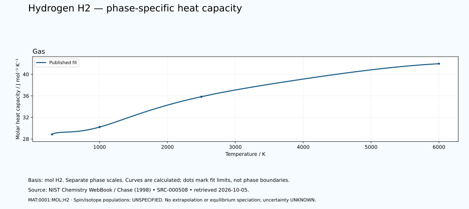

# Hydrogen — thermal functions and phase-specific heat capacity

<!-- generated-by: sync-thermochemistry.mjs -->

3 published Shomate fits are available in this dated NIST Chemistry WebBook extraction. The hydrogen basis is one mole of H₂ molecules, containing two moles of hydrogen atoms. No factor-of-two conversion to atomic hydrogen has been applied.

Canonical subject: **MAT:0001:MOL:H2** (MOLECULE), defined by the [unchanged curated owner](data/structured/0001-Hydrogen-H.yaml) at `/molecular_states/H2`. Spin-isomer scope and isotopic composition are **UNSPECIFIED-IN-RETAINED-FIT**. No normal/para/ortho composition, cryogenic equilibrium, atomic-species substitution or dissociation calculation is inferred.
 The element's wider thermal domain remains PARTIAL.

[Parent record](0001-Hydrogen-H.md) · [Structured coefficients](data/structured/0001-Hydrogen-H-NIST-Thermochemistry.yaml) · [Calculated table](tables/0001-Hydrogen-H-TABLE-010-Thermodynamic-Functions.md) · [CSV](tables/0001-Hydrogen-H-TABLE-010-Thermodynamic-Functions.csv)

Source: **SRC-000508**, [NIST Chemistry WebBook](https://webbook.nist.gov/cgi/cbook.cgi?ID=C1333740&Mask=1), retrieved 2026-10-05. [Retained coefficient source](../../data/catalog/sources/nist-thermochemistry-0001-2026-10-05.html.txt) and [publisher's rounded comparison table](../../data/catalog/sources/nist-thermochemistry-0001-2026-10-05-table.html.txt) preserve the exact downloaded bytes and their SHA-256 hashes. The original evaluation is Chase (1998), with each earlier review date retained below.

## Applicable states and intervals

| Fit | Source phase variant | Valid T / K | Source comment |
|---|---|---:|---|
| GAS:1 | UNSPECIFIED-IN-FIT-TABLE | 298–1000 | Data last reviewed in March, 1977; New parameter fit October 2001 |
| GAS:2 | UNSPECIFIED-IN-FIT-TABLE | 1000–2500 | Data last reviewed in March, 1977; New parameter fit October 2001 |
| GAS:3 | UNSPECIFIED-IN-FIT-TABLE | 2500–6000 | Data last reviewed in March, 1977; New parameter fit October 2001 |

A fit interval describes where the publisher supplies coefficients. Its endpoints are not automatically melting points, boiling points or equilibrium phase boundaries. Alternative solid phases may have overlapping ranges. The source's unspecified crystal structure is UNKNOWN. Each gas fit concerns its listed species; dissociation and ionisation equilibria are not calculated. Standard thermochemical functions do not supply arbitrary-pressure behaviour.

## Equations and reference states

With t = T/1000 and T in kelvin, use the exact source A–H coefficients in their published mixed-unit convention:

- Cp° = A + B·t + C·t² + D·t³ + E/t², in J mol⁻¹ K⁻¹.
- H°(T)−H°(298.15 K) = A·t + B·t²/2 + C·t³/3 + D·t⁴/4 − E/t + F − H, in kJ mol⁻¹.
- S° = A·ln(t) + B·t + C·t²/2 + D·t³/3 − E/(2·t²) + G, in J mol⁻¹ K⁻¹.

The last H is a coefficient, not the temperature-dependent enthalpy. Phase-specific reference offsets matter: do not splice enthalpy increments from different phases or interpret coefficient H as latent heat. The 298.15 K reference does not permit extrapolating a high-temperature fit down to 298.15 K. Outside-range evaluation is rejected. Unpublished coefficient uncertainty and covariance remain UNKNOWN; no error bars or extra physical precision are invented.

## Fit-specific scientific review

**SOURCE-SCOPE-LIMITATION: MAT:0001:THERMO:REVIEW:01.** Neutral molecular H2 only; not atomic H, an ion or elemental composition averaged over species. One mole of H2 contains two moles of H atoms. UNSPECIFIED-IN-RETAINED-SHOMATE-TABLE. Other-name aliases o-Hydrogen and p-Hydrogen do not assign the three fits to normal, para, ortho or equilibrium H2 and do not establish any numeric spin fraction. Only GAS Shomate fits are supplied, 298–6000 K. Do not extrapolate to the 20.271 K equilibrium-H2 boiling point, cryogenic liquid/solid, phase changes or spin conversion. No temperature-dependent dissociation, ionisation or equilibrium species/spin populations are calculated. Source: SRC-000508. Evidence: SOURCE-TRANSCRIBED; INDEPENDENT-SCIENTIFIC-REVIEW-PENDING.

**SOURCE-SCOPE-LIMITATION: MAT:0001:THERMO:REVIEW:02.** The page labels separate gas entropy reference data at 1 bar. The Shomate equations carry standard-state superscripts and no pressure input; an applied sample pressure or arbitrary-pressure EOS is not supplied. H equation reports H(T)-H(298.15 K) in kJ/mol H2; entropy and Cp use J/mol H2/K. Fit minimum 298 K is not a new standard reference. The coefficients provide no coefficient uncertainties or covariance; quantity uncertainty remains UNKNOWN. Publisher rounding and numerical derivative residuals are software/source-format checks, not physical uncertainty. Source: SRC-000508. Evidence: SOURCE-TRANSCRIBED; INDEPENDENT-SCIENTIFIC-REVIEW-PENDING.

## Heat-capacity chart

Each panel uses its own temperature scale. Lines sample the published equation; they are not observations or phase-stability predictions. Unknown uncertainties are not zero. These calculated charts supplement the chapter and do not replace any of the 22 requested illustrations.

## Validation and outstanding thermal data

The calculation is checked against the publisher's separately tabulated rounded values and the thermodynamic identities dH/dT = Cp and dS/dT = Cp/T. These checks verify transcription and arithmetic, not independent experimental validity. The source tables retain older evaluations; later measurements and application-specific state conditions need separate review. Thermal conductivity, diffusivity, expansion, pressure dependence, transition enthalpies and a phase diagram remain INSUFFICIENT DATA in this supplement. Existing phase-reference values are preserved for later source reconciliation.
