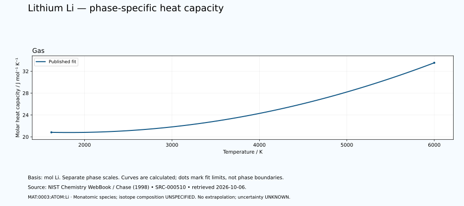

# Lithium — thermal functions and phase-specific heat capacity

<!-- generated-by: sync-thermochemistry.mjs -->

1 published Shomate fits are available in this dated NIST Chemistry WebBook extraction. The lithium basis is one mole of neutral Li atoms. The listed monatomic gas species is not a dimer, an isotope-specific equation of state or all species in an equilibrium vapour.

Canonical subject: **MAT:0003:ATOM:Li** (ATOM), defined by the [unchanged curated owner](data/structured/0003-Lithium-Li.yaml) at `/states/0`. Molecular spin-isomer scope is **NOT-APPLICABLE-TO-MONATOMIC-SPECIES**. Isotopic composition is **UNSPECIFIED-IN-RETAINED-FIT**. No particular isotope, dimer population, cryogenic equilibrium or superfluid transition is inferred.
 The element's wider thermal domain remains PARTIAL.

[Parent record](0003-Lithium-Li.md) · [Structured coefficients](data/structured/0003-Lithium-Li-NIST-Thermochemistry.yaml) · [Calculated table](tables/0003-Lithium-Li-TABLE-010-Thermodynamic-Functions.md) · [CSV](tables/0003-Lithium-Li-TABLE-010-Thermodynamic-Functions.csv)

Source: **SRC-000510**, [NIST Chemistry WebBook](https://webbook.nist.gov/cgi/cbook.cgi?ID=C7439932&Units=SI&Mask=1), retrieved 2026-10-06. [Retained coefficient source](../../data/catalog/sources/nist-thermochemistry-0003-2026-10-06.html.txt) and [publisher's rounded comparison table](../../data/catalog/sources/nist-thermochemistry-0003-2026-10-06-table.html.txt) preserve the exact downloaded bytes and their SHA-256 hashes. The original evaluation is Chase (1998), with each earlier review date retained below.

## Applicable states and intervals

| Fit | Source phase variant | Valid T / K | Source comment |
|---|---|---:|---|
| GAS:1 | UNSPECIFIED-IN-FIT-TABLE | 1620.12–6000 | Data last reviewed in June, 1962 |

A fit interval describes where the publisher supplies coefficients. Its endpoints are not automatically melting points, boiling points or equilibrium phase boundaries. Alternative solid phases may have overlapping ranges. The source's unspecified crystal structure is UNKNOWN. Each gas fit concerns its listed species; dissociation and ionisation equilibria are not calculated. Standard thermochemical functions do not supply arbitrary-pressure behaviour.

## Equations and reference states

With t = T/1000 and T in kelvin, use the exact source A–H coefficients in their published mixed-unit convention:

- Cp° = A + B·t + C·t² + D·t³ + E/t², in J mol⁻¹ K⁻¹.
- H°(T)−H°(298.15 K) = A·t + B·t²/2 + C·t³/3 + D·t⁴/4 − E/t + F − H, in kJ mol⁻¹.
- S° = A·ln(t) + B·t + C·t²/2 + D·t³/3 − E/(2·t²) + G, in J mol⁻¹ K⁻¹.

The last H is a coefficient, not the temperature-dependent enthalpy. Phase-specific reference offsets matter: do not splice enthalpy increments from different phases or interpret coefficient H as latent heat. The 298.15 K reference does not permit extrapolating a high-temperature fit down to 298.15 K. Outside-range evaluation is rejected. Unpublished coefficient uncertainty and covariance remain UNKNOWN; no error bars or extra physical precision are invented.

## Fit-specific scientific review

**SOURCE-SCOPE-LIMITATION: MAT:0003:THERMO:REVIEW:01.** The exact publisher species is Li with InChI=1S/Li, not Li2, Li ions or an equilibrium vapor mixture. One mole of the source species is one mole of Li atoms. No molecular factor of two applies. Existing Li-6/Li-7 records and atomic-weight intervals retain separate scope. No isotope-specific gas properties or numeric isotope abundances are inferred from this elemental fit or its listed molecular weight. No Li/Li2 equilibrium fraction, dimer dissociation, ionisation fraction, charge-state mixture or molecular nuclear-spin population is calculated or assigned. Source: SRC-000510. Evidence: SOURCE-TRANSCRIBED; INDEPENDENT-SCIENTIFIC-REVIEW-PENDING.

**SOURCE-SCOPE-LIMITATION: MAT:0003:THERMO:REVIEW:02.** The gas-only response supplies one fit for 1620.12–6000 K. A separate retained condensed-phase diagnostic contains two LIQUID fits and one SOLID fit. Those fits are not imported, relabelled, or bound to the neutral atomic GAS state. No gas evaluation below the source minimum 1620.12 K is justified. The retained source limits do not themselves establish a boiling point, a gas stability boundary or a pressure-dependent phase boundary. The Shomate equations contain no pressure variable. Applied pressure, arbitrary-pressure EOS and phase diagrams are not inferred. Separate source entropy reference-pressure labels belong to those original data only. Fit boundaries from separate phases and enthalpy reference offsets are retained as reported and are not a constructed phase-transition path or latent-heat calculation. Coefficient uncertainty and covariance are unreported. Printed-temperature cells, output rounding and numerical derivative residuals are source-format/software checks, not physical uncertainty. Independent transcription arithmetic against publisher values and positive samples within the fit do not establish experimental replication, new calorimetry, complete Lithium thermophysics or element completion. The source enthalpy increment is H(T)-H(298.15 K); its supplied reference offset does not authorize evaluating this gas fit at 298.15 K or inferring a solid-to-gas transition. Source: SRC-000510. Evidence: SOURCE-TRANSCRIBED; INDEPENDENT-SCIENTIFIC-REVIEW-PENDING.

**PUBLISHER-TEMPERATURE-ROUNDING-REVIEW: MAT:0003:THERMO:REVIEW:03.** The publisher prints the first temperature as 1620., nominally below the retained 1620.12 K fit minimum. Its printed-temperature rounding interval 1619.5–1620.5 K contains that exact source boundary, and Cp, entropy and enthalpy-increment outputs agree there at their printed precision. Preserve the raw row and explicit calculation_temperature_K=1620.12 resolution; do not evaluate an accepted sample at 1620 K, enlarge fit validity, widen tolerances or treat source rounding as physical uncertainty. Source: SRC-000510. Evidence: PUBLISHER-CALCULATION-CHECK; INDEPENDENT-SCIENTIFIC-REVIEW-PENDING.

## Heat-capacity chart

Each panel uses its own temperature scale. Lines sample the published equation; they are not observations or phase-stability predictions. Unknown uncertainties are not zero. These calculated charts supplement the chapter and do not replace any of the 22 requested illustrations.

## Validation and outstanding thermal data

The calculation is checked against the publisher's separately tabulated rounded values and the thermodynamic identities dH/dT = Cp and dS/dT = Cp/T. These checks verify transcription and arithmetic, not independent experimental validity. The source tables retain older evaluations; later measurements and application-specific state conditions need separate review. Thermal conductivity, diffusivity, expansion, pressure dependence, transition enthalpies and a phase diagram remain INSUFFICIENT DATA in this supplement. Existing phase-reference values are preserved for later source reconciliation.
