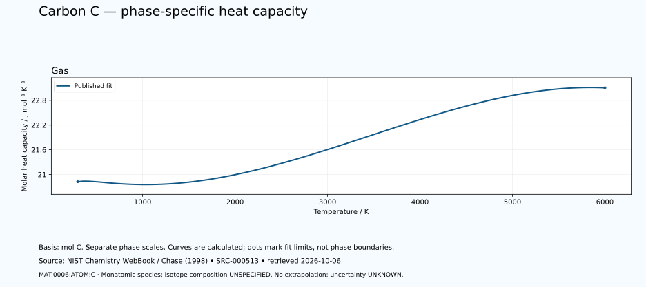

# Carbon — thermal functions and phase-specific heat capacity

<!-- generated-by: sync-thermochemistry.mjs -->

1 published Shomate fits are available in this dated NIST Chemistry WebBook extraction. The carbon basis is one mole of neutral C atoms. The listed monatomic gas species is not a dimer, an isotope-specific equation of state or all species in an equilibrium vapour.

Canonical subject: **MAT:0006:ATOM:C** (ATOM), defined by the [unchanged curated owner](data/structured/0006-Carbon-C.yaml) at `/states/0`. Molecular spin-isomer scope is **NOT-APPLICABLE-TO-MONATOMIC-SPECIES**. Isotopic composition is **UNSPECIFIED-IN-RETAINED-FIT**. No particular isotope, dimer population, cryogenic equilibrium or superfluid transition is inferred.
 The element's wider thermal domain remains PARTIAL.

[Parent record](0006-Carbon-C.md) · [Structured coefficients](data/structured/0006-Carbon-C-NIST-Thermochemistry.yaml) · [Calculated table](tables/0006-Carbon-C-TABLE-011-Thermodynamic-Functions.md) · [CSV](tables/0006-Carbon-C-TABLE-011-Thermodynamic-Functions.csv)

Source: **SRC-000513**, [NIST Chemistry WebBook](https://webbook.nist.gov/cgi/cbook.cgi?ID=C7440440&Units=SI&Mask=1), retrieved 2026-10-06. [Retained coefficient source](../../data/catalog/sources/nist-thermochemistry-0006-2026-10-06.html.txt) and [publisher's rounded comparison table](../../data/catalog/sources/nist-thermochemistry-0006-2026-10-06-table.html.txt) preserve the exact downloaded bytes and their SHA-256 hashes. The original evaluation is Chase (1998), with each earlier review date retained below.

## Applicable states and intervals

| Fit | Source phase variant | Valid T / K | Source comment |
|---|---|---:|---|
| GAS:1 | UNSPECIFIED-IN-FIT-TABLE | 298–6000 | Data last reviewed in March, 1983 |

A fit interval describes where the publisher supplies coefficients. Its endpoints are not automatically melting points, boiling points or equilibrium phase boundaries. Alternative solid phases may have overlapping ranges. The source's unspecified crystal structure is UNKNOWN. Each gas fit concerns its listed species; dissociation and ionisation equilibria are not calculated. Standard thermochemical functions do not supply arbitrary-pressure behaviour.

## Equations and reference states

With t = T/1000 and T in kelvin, use the exact source A–H coefficients in their published mixed-unit convention:

- Cp° = A + B·t + C·t² + D·t³ + E/t², in J mol⁻¹ K⁻¹.
- H°(T)−H°(298.15 K) = A·t + B·t²/2 + C·t³/3 + D·t⁴/4 − E/t + F − H, in kJ mol⁻¹.
- S° = A·ln(t) + B·t + C·t²/2 + D·t³/3 − E/(2·t²) + G, in J mol⁻¹ K⁻¹.

The last H is a coefficient, not the temperature-dependent enthalpy. Phase-specific reference offsets matter: do not splice enthalpy increments from different phases or interpret coefficient H as latent heat. The 298.15 K reference does not permit extrapolating a high-temperature fit down to 298.15 K. Outside-range evaluation is rejected. Unpublished coefficient uncertainty and covariance remain UNKNOWN; no error bars or extra physical precision are invented.

## Fit-specific scientific review

**SOURCE-SCOPE-LIMITATION: MAT:0006:THERMO:REVIEW:01.** The exact GAS fit species is C with InChI=1S/C: neutral monatomic carbon, not C2, C3, carbon ions or an equilibrium vapor mixture. One mole of source species is one mole of C atoms. Shared CAS/formula aliases and links to diamond/graphite do not make this gas fit a condensed-material function. Existing C-12/C-13/C-14 records, atomic-weight and metrological references retain separate scope. No isotope-specific functions or isotope fractions follow from the fit or listed molecular weight. No C/C2/C3 equilibrium fraction, molecular dissociation, ionisation fraction, charge-state mixture or nuclear-spin population is calculated. Source: SRC-000513. Evidence: SOURCE-TRANSCRIBED; INDEPENDENT-SCIENTIFIC-REVIEW-PENDING.

**SOURCE-SCOPE-LIMITATION: MAT:0006:THERMO:REVIEW:02.** One GAS fit covers 298–6000 K. The separately retained condensed page is a private diagnostic; none of its observations or fits is accepted or bound to the neutral atomic GAS owner. No evaluation below 298 K is justified. The valid fit does permit evaluation at 298.15 K, but gas functions at low temperatures describe the specified standard-state species, not the stable ambient solid or equilibrium gas abundance. Source limits do not establish a gas stability or phase boundary. The Shomate equations have no pressure variable. Applied pressure, arbitrary-pressure EOS and phase diagrams are not inferred; original one-bar standard-entropy rows have their own reference context. Published enthalpy reference offsets are retained. No gas-to-diamond/graphite transition path, latent heat or equilibrium phase diagram is constructed. Coefficient uncertainty and covariance are unreported. Source output rounding and derivative residuals are software/source-format checks, not physical uncertainty. Separate CODATA review uncertainties are not coefficient errors. Direct source transcription and independent Python/JavaScript arithmetic checks do not establish independent calorimetry, experimental replication or complete Carbon thermophysics. Auxiliary human/model-independent review is unavailable due to the account usage limit. The fit includes 298.15 K; retain its published enthalpy-reference offset without forcing a computed residual to zero. SRC-000085 is distinct CODATA graphite standard-state/formation work, not this Chase/WebBook atomic-gas fit. Existing diamond, graphite, graphene, nanotube, fullerene, amorphous and compound owners retain separate contexts. Source: SRC-000513. Evidence: SOURCE-TRANSCRIBED; INDEPENDENT-SCIENTIFIC-REVIEW-PENDING.

## Heat-capacity chart

Each panel uses its own temperature scale. Lines sample the published equation; they are not observations or phase-stability predictions. Unknown uncertainties are not zero. These calculated charts supplement the chapter and do not replace any of the 22 requested illustrations.

## Validation and outstanding thermal data

The calculation is checked against the publisher's separately tabulated rounded values and the thermodynamic identities dH/dT = Cp and dS/dT = Cp/T. These checks verify transcription and arithmetic, not independent experimental validity. The source tables retain older evaluations; later measurements and application-specific state conditions need separate review. Thermal conductivity, diffusivity, expansion, pressure dependence, transition enthalpies and a phase diagram remain INSUFFICIENT DATA in this supplement. Existing phase-reference values are preserved for later source reconciliation.
