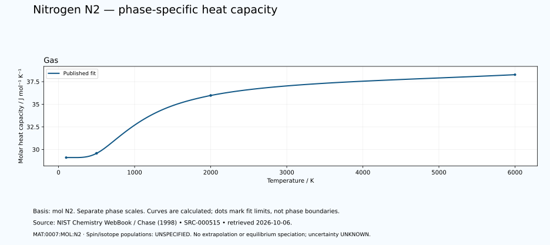

# Nitrogen — thermal functions and phase-specific heat capacity

<!-- generated-by: sync-thermochemistry.mjs -->

3 published Shomate fits are available in this dated NIST Chemistry WebBook extraction. The nitrogen basis is one mole of N₂ molecules, containing two moles of nitrogen atoms. No factor-of-two conversion to atomic nitrogen has been applied.

Canonical subject: **MAT:0007:MOL:N2** (MOLECULE), defined by the [unchanged curated owner](data/structured/0007-Nitrogen-N.yaml) at `/ordinary_molecular_state`. Spin-isomer scope and isotopic composition are **UNSPECIFIED-IN-RETAINED-FIT**. No normal/para/ortho composition, cryogenic equilibrium, atomic-species substitution or dissociation calculation is inferred.
 The element's wider thermal domain remains PARTIAL.

[Parent record](0007-Nitrogen-N.md) · [Structured coefficients](data/structured/0007-Nitrogen-N-NIST-Thermochemistry.yaml) · [Calculated table](tables/0007-Nitrogen-N-TABLE-011-Thermodynamic-Functions.md) · [CSV](tables/0007-Nitrogen-N-TABLE-011-Thermodynamic-Functions.csv)

Source: **SRC-000515**, [NIST Chemistry WebBook](https://webbook.nist.gov/cgi/cbook.cgi?ID=C7727379&Units=SI&Mask=1), retrieved 2026-10-06. [Retained coefficient source](../../data/catalog/sources/nist-thermochemistry-0007-2026-10-06.html.txt) and [publisher's rounded comparison table](../../data/catalog/sources/nist-thermochemistry-0007-2026-10-06-table.html.txt) preserve the exact downloaded bytes and their SHA-256 hashes. The original evaluation is Chase (1998), with each earlier review date retained below.

## Applicable states and intervals

| Fit | Source phase variant | Valid T / K | Source comment |
|---|---|---:|---|
| GAS:1 | UNSPECIFIED-IN-FIT-TABLE | 100–500 | Data last reviewed in March, 1977; New parameter fit January 2009 |
| GAS:2 | UNSPECIFIED-IN-FIT-TABLE | 500–2000 | Data last reviewed in March, 1977; New parameter fit January 2009 |
| GAS:3 | UNSPECIFIED-IN-FIT-TABLE | 2000–6000 | Data last reviewed in March, 1977; New parameter fit January 2009 |

A fit interval describes where the publisher supplies coefficients. Its endpoints are not automatically melting points, boiling points or equilibrium phase boundaries. Alternative solid phases may have overlapping ranges. The source's unspecified crystal structure is UNKNOWN. Each gas fit concerns its listed species; dissociation and ionisation equilibria are not calculated. Standard thermochemical functions do not supply arbitrary-pressure behaviour.

## Equations and reference states

With t = T/1000 and T in kelvin, use the exact source A–H coefficients in their published mixed-unit convention:

- Cp° = A + B·t + C·t² + D·t³ + E/t², in J mol⁻¹ K⁻¹.
- H°(T)−H°(298.15 K) = A·t + B·t²/2 + C·t³/3 + D·t⁴/4 − E/t + F − H, in kJ mol⁻¹.
- S° = A·ln(t) + B·t + C·t²/2 + D·t³/3 − E/(2·t²) + G, in J mol⁻¹ K⁻¹.

The last H is a coefficient, not the temperature-dependent enthalpy. Phase-specific reference offsets matter: do not splice enthalpy increments from different phases or interpret coefficient H as latent heat. The 298.15 K reference does not permit extrapolating a high-temperature fit down to 298.15 K. Outside-range evaluation is rejected. Unpublished coefficient uncertainty and covariance remain UNKNOWN; no error bars or extra physical precision are invented.

## Fit-specific scientific review

**SOURCE-SCOPE-LIMITATION: MAT:0007:THERMO:REVIEW:01.** The retained species is molecular N2 (CAS 7727-37-9, InChI=1S/N2/c1-2), GAS, with one mole of N2 molecules containing two moles of nitrogen atoms. Bind MAT:0007:MOL:N2 at /ordinary_molecular_state; do not bind MAT:0007:ATOM:N or convert molecular functions to atomic functions by dividing by two. Source aliases including Nitrogen-14 and reported molecular weight do not specify isotopic fractions. Isotope composition and spin-isomer scope are UNSPECIFIED-IN-RETAINED-FIT. No dissociation, ionisation fraction, equilibrium composition or spin population is derived. Source: SRC-000515. Evidence: SOURCE-TRANSCRIBED; INDEPENDENT-SCIENTIFIC-REVIEW-PENDING.

**SOURCE-SCOPE-LIMITATION: MAT:0007:THERMO:REVIEW:02.** Three GAS columns cover 100–500 K, 500–2000 K and 2000–6000 K. Keep both publisher rows at 500 K and 2000 K tied to their separate source columns; the rounded 2000 K heat capacities differ. Do not merge, average or impose continuity, infer a transition, or extrapolate below 100 K or above 6000 K. Existing atomic, liquid/cryogenic, phase-reference, cg-N and ammonia reaction owners remain separate. Retain the published enthalpy reference and any calculated reference residual rather than forcing zero. Source: SRC-000515. Evidence: SOURCE-TRANSCRIBED; INDEPENDENT-SCIENTIFIC-REVIEW-PENDING.

**SOURCE-SCOPE-LIMITATION: MAT:0007:THERMO:REVIEW:03.** Retain Chase 1998, the reported March 1977 data review, January 2009 parameter fit, and 2026-10-06 retrieval as distinct provenance. The Shomate equations have no pressure variable; preserve their reported standard-state quantities and the separate gas, one-bar entropy datum without assigning an arbitrary sample pressure. Coefficient uncertainty and covariance are UNKNOWN. Separate CODATA entropy uncertainty, publisher output rounding and software arithmetic residuals are not coefficient uncertainty or independent measurement confirmation. This candidate capture and independent arithmetic review do not accept science, establish calorimetry or experimental replication, or complete Nitrogen thermophysics. A newly dated snapshot should record same_work_as SRC-000102; its old spectroscopy supports and identity ownership are preserved. Source: SRC-000515. Evidence: SOURCE-TRANSCRIBED; INDEPENDENT-SCIENTIFIC-REVIEW-PENDING.

## Heat-capacity chart

Each panel uses its own temperature scale. Lines sample the published equation; they are not observations or phase-stability predictions. Unknown uncertainties are not zero. These calculated charts supplement the chapter and do not replace any of the 22 requested illustrations.

## Validation and outstanding thermal data

The calculation is checked against the publisher's separately tabulated rounded values and the thermodynamic identities dH/dT = Cp and dS/dT = Cp/T. These checks verify transcription and arithmetic, not independent experimental validity. The source tables retain older evaluations; later measurements and application-specific state conditions need separate review. Thermal conductivity, diffusivity, expansion, pressure dependence, transition enthalpies and a phase diagram remain INSUFFICIENT DATA in this supplement. Existing phase-reference values are preserved for later source reconciliation.
