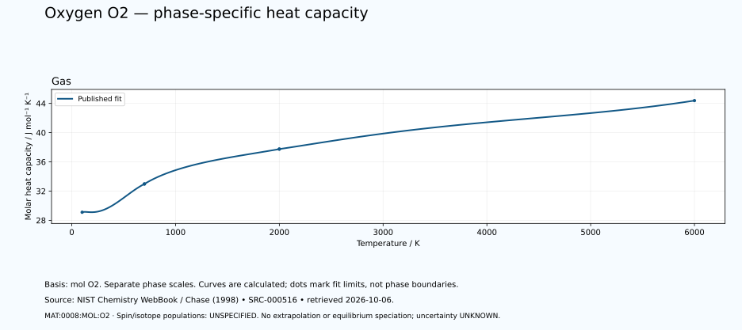

# Oxygen — thermal functions and phase-specific heat capacity

<!-- generated-by: sync-thermochemistry.mjs -->

3 published Shomate fits are available in this dated NIST Chemistry WebBook extraction. The oxygen basis is one mole of O₂ molecules, containing two moles of oxygen atoms. No factor-of-two conversion to atomic oxygen has been applied.

Canonical subject: **MAT:0008:MOL:O2** (MOLECULE), defined by the [unchanged curated owner](data/structured/0008-Oxygen-O.yaml) at `/ordinary_molecular_state`. Spin-isomer scope and isotopic composition are **UNSPECIFIED-IN-RETAINED-FIT**. No normal/para/ortho composition, cryogenic equilibrium, atomic-species substitution or dissociation calculation is inferred.
 The element's wider thermal domain remains PARTIAL.

[Parent record](0008-Oxygen-O.md) · [Structured coefficients](data/structured/0008-Oxygen-O-NIST-Thermochemistry.yaml) · [Calculated table](tables/0008-Oxygen-O-TABLE-011-Thermodynamic-Functions.md) · [CSV](tables/0008-Oxygen-O-TABLE-011-Thermodynamic-Functions.csv)

Source: **SRC-000516**, [NIST Chemistry WebBook](https://webbook.nist.gov/cgi/cbook.cgi?ID=C7782447&Units=SI&Mask=1), retrieved 2026-10-06. [Retained coefficient source](../../data/catalog/sources/nist-thermochemistry-0008-2026-10-06.html.txt) and [publisher's rounded comparison table](../../data/catalog/sources/nist-thermochemistry-0008-2026-10-06-table.html.txt) preserve the exact downloaded bytes and their SHA-256 hashes. The original evaluation is Chase (1998), with each earlier review date retained below.

## Applicable states and intervals

| Fit | Source phase variant | Valid T / K | Source comment |
|---|---|---:|---|
| GAS:1 | UNSPECIFIED-IN-FIT-TABLE | 100–700 | Data last reviewed in March, 1977; New parameter fit January 2009 |
| GAS:2 | UNSPECIFIED-IN-FIT-TABLE | 700–2000 | Data last reviewed in March, 1977; New parameter fit January 2009 |
| GAS:3 | UNSPECIFIED-IN-FIT-TABLE | 2000–6000 | Data last reviewed in March, 1977; New parameter fit January 2009 |

A fit interval describes where the publisher supplies coefficients. Its endpoints are not automatically melting points, boiling points or equilibrium phase boundaries. Alternative solid phases may have overlapping ranges. The source's unspecified crystal structure is UNKNOWN. Each gas fit concerns its listed species; dissociation and ionisation equilibria are not calculated. Standard thermochemical functions do not supply arbitrary-pressure behaviour.

## Equations and reference states

With t = T/1000 and T in kelvin, use the exact source A–H coefficients in their published mixed-unit convention:

- Cp° = A + B·t + C·t² + D·t³ + E/t², in J mol⁻¹ K⁻¹.
- H°(T)−H°(298.15 K) = A·t + B·t²/2 + C·t³/3 + D·t⁴/4 − E/t + F − H, in kJ mol⁻¹.
- S° = A·ln(t) + B·t + C·t²/2 + D·t³/3 − E/(2·t²) + G, in J mol⁻¹ K⁻¹.

The last H is a coefficient, not the temperature-dependent enthalpy. Phase-specific reference offsets matter: do not splice enthalpy increments from different phases or interpret coefficient H as latent heat. The 298.15 K reference does not permit extrapolating a high-temperature fit down to 298.15 K. Outside-range evaluation is rejected. Unpublished coefficient uncertainty and covariance remain UNKNOWN; no error bars or extra physical precision are invented.

## Fit-specific scientific review

**SOURCE-SCOPE-LIMITATION: MAT:0008:THERMO:REVIEW:01.** The retained species is molecular O2, GAS, CAS 7782-44-7, InChI=1S/O2/c1-2. One mole of O2 molecules contains two moles of oxygen atoms; this is a species-count relation, not a thermodynamic molecular-to-atomic conversion. Bind MAT:0008:MOL:O2 at /ordinary_molecular_state with mol O2 basis. The master atomic ID is only a string at /oxygen_species/0; the separate ASD atomic entry is not a molecular thermal owner. No atomic O, O3, excited singlet O2, radical, oxide, peroxide or superoxide function follows. Isotopic composition and spin scope are UNSPECIFIED-IN-RETAINED-FIT; the authored triplet ground term does not resolve spin populations or isotope fractions over the fit domain. Source: SRC-000516. Evidence: SOURCE-TRANSCRIBED; INDEPENDENT-SCIENTIFIC-REVIEW-PENDING.

**SOURCE-SCOPE-LIMITATION: MAT:0008:THERMO:REVIEW:02.** Three GAS columns cover 100–700 K, 700–2000 K and 2000–6000 K. Preserve each of the 62 publisher rows and both copies of the shared 700 K and 2000 K endpoints with their source columns. The rounded 2000 K enthalpy increments differ; do not average, impose continuity or infer a phase transition/physical uncertainty. Preserve the published enthalpy reference and calculated residual at 298.15 K. No extrapolation below 100 K or above 6000 K, liquid/solid oxygen, cryogenic fluid EOS, high-pressure magnetism/phase boundary, latent heat or equilibrium dissociation/ionisation mixture is inferred. Source aliases such as liquid oxygen and phase links do not change this GAS fit into a condensed function. Source: SRC-000516. Evidence: SOURCE-TRANSCRIBED; INDEPENDENT-SCIENTIFIC-REVIEW-PENDING.

**SOURCE-SCOPE-LIMITATION: MAT:0008:THERMO:REVIEW:03.** Retain Chase 1998, the reported March 1977 data review, January 2009 new parameter fit, actual 2026-10-06 source retrieval, and 2026-10-07 private software review as distinct provenance. Shomate has no pressure variable: applied sample pressure is UNKNOWN; retain the reported standard-state context and separate one-bar entropy datum without arbitrary-pressure EOS. Coefficient uncertainty/covariance remain UNKNOWN. Separate CODATA entropy uncertainty, publisher output rounding and software residuals are not coefficient uncertainty. Independent parsing and Python/JavaScript arithmetic against the same publisher data do not establish independent measurements, calorimetry, experimental replication, uncertainty acceptance or complete Oxygen thermophysics. A dated WebBook snapshot should propose same_work_as SRC-000127/SRC-O-002; SRC-000133/SRC-O-THERMO-001 is distinct cryogenic/fluid work. Preserve all existing source supports and owners. Source: SRC-000516. Evidence: SOURCE-TRANSCRIBED; INDEPENDENT-SCIENTIFIC-REVIEW-PENDING.

## Heat-capacity chart

Each panel uses its own temperature scale. Lines sample the published equation; they are not observations or phase-stability predictions. Unknown uncertainties are not zero. These calculated charts supplement the chapter and do not replace any of the 22 requested illustrations.

## Validation and outstanding thermal data

The calculation is checked against the publisher's separately tabulated rounded values and the thermodynamic identities dH/dT = Cp and dS/dT = Cp/T. These checks verify transcription and arithmetic, not independent experimental validity. The source tables retain older evaluations; later measurements and application-specific state conditions need separate review. Thermal conductivity, diffusivity, expansion, pressure dependence, transition enthalpies and a phase diagram remain INSUFFICIENT DATA in this supplement. Existing phase-reference values are preserved for later source reconciliation.
