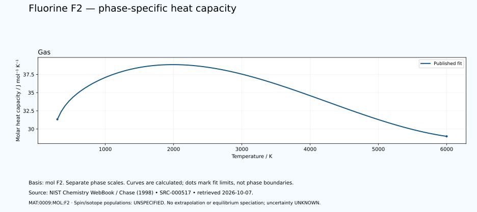

# Fluorine — thermal functions and phase-specific heat capacity

<!-- generated-by: sync-thermochemistry.mjs -->

1 published Shomate fits are available in this dated NIST Chemistry WebBook extraction. The fluorine basis is one mole of F₂ molecules, containing two moles of fluorine atoms. No factor-of-two conversion to atomic fluorine has been applied.

Canonical subject: **MAT:0009:MOL:F2** (MOLECULE), defined by the [unchanged curated owner](data/structured/0009-Fluorine-F.yaml) at `/ordinary_molecular_state`. Spin-isomer scope and isotopic composition are **UNSPECIFIED-IN-RETAINED-FIT**. No normal/para/ortho composition, cryogenic equilibrium, atomic-species substitution or dissociation calculation is inferred.
 The element's wider thermal domain remains PARTIAL.

[Parent record](0009-Fluorine-F.md) · [Structured coefficients](data/structured/0009-Fluorine-F-NIST-Thermochemistry.yaml) · [Calculated table](tables/0009-Fluorine-F-TABLE-011-Thermodynamic-Functions.md) · [CSV](tables/0009-Fluorine-F-TABLE-011-Thermodynamic-Functions.csv)

Source: **SRC-000517**, [NIST Chemistry WebBook](https://webbook.nist.gov/cgi/cbook.cgi?ID=C7782414&Units=SI&Mask=1), retrieved 2026-10-07. [Retained coefficient source](../../data/catalog/sources/nist-thermochemistry-0009-2026-10-07.html.txt) and [publisher's rounded comparison table](../../data/catalog/sources/nist-thermochemistry-0009-2026-10-07-table.html.txt) preserve the exact downloaded bytes and their SHA-256 hashes. The original evaluation is Chase (1998), with each earlier review date retained below.

## Applicable states and intervals

| Fit | Source phase variant | Valid T / K | Source comment |
|---|---|---:|---|
| GAS:1 | UNSPECIFIED-IN-FIT-TABLE | 298–6000 | Data last reviewed in June, 1982 |

A fit interval describes where the publisher supplies coefficients. Its endpoints are not automatically melting points, boiling points or equilibrium phase boundaries. Alternative solid phases may have overlapping ranges. The source's unspecified crystal structure is UNKNOWN. Each gas fit concerns its listed species; dissociation and ionisation equilibria are not calculated. Standard thermochemical functions do not supply arbitrary-pressure behaviour.

## Equations and reference states

With t = T/1000 and T in kelvin, use the exact source A–H coefficients in their published mixed-unit convention:

- Cp° = A + B·t + C·t² + D·t³ + E/t², in J mol⁻¹ K⁻¹.
- H°(T)−H°(298.15 K) = A·t + B·t²/2 + C·t³/3 + D·t⁴/4 − E/t + F − H, in kJ mol⁻¹.
- S° = A·ln(t) + B·t + C·t²/2 + D·t³/3 − E/(2·t²) + G, in J mol⁻¹ K⁻¹.

The last H is a coefficient, not the temperature-dependent enthalpy. Phase-specific reference offsets matter: do not splice enthalpy increments from different phases or interpret coefficient H as latent heat. The 298.15 K reference does not permit extrapolating a high-temperature fit down to 298.15 K. Outside-range evaluation is rejected. Unpublished coefficient uncertainty and covariance remain UNKNOWN; no error bars or extra physical precision are invented.

## Fit-specific scientific review

**SOURCE-SCOPE-LIMITATION: MAT:0009:THERMO:REVIEW:01.** The retained species is molecular F2 GAS, CAS7782-41-4, InChI=1S/F2/c1-2. One mole of F2 molecules contains two moles of fluorine atoms; this species-count relation does not convert thermodynamic F2 functions to atomic F. Bind MAT:0009:MOL:F2 at /ordinary_molecular_state with mol F2 basis. Atomic /atomic_state lacks explicit charge=0 and /fluoride is a distinct ion. No atomic F, fluoride F-, HF, compound or equilibrium dissociation/ionisation mixture follows. The molecular closed-shell ground state and authored monoisotopic natural composition do not supply fit-resolved isotope or spin scope. Source: SRC-000517. Evidence: SOURCE-TRANSCRIBED; INDEPENDENT-SCIENTIFIC-REVIEW-PENDING.

**SOURCE-SCOPE-LIMITATION: MAT:0009:THERMO:REVIEW:02.** One GAS Shomate column covers298–6000 K. Preserve all59 publisher rows, including raw298 K first row and its negative-zero rounded enthalpy; distinguish this printed temperature from the298.15 K published enthalpy reference. Retain the calculated reference residual; do not force zero. This one-column source has no duplicated inter-fit endpoints. No below298K/above6000K extrapolation, liquid/solid/cryogenic fluorine, fluid EOS, phase transitions, latent heat or pressure-dependent function is inferred. Source: SRC-000517. Evidence: SOURCE-TRANSCRIBED; INDEPENDENT-SCIENTIFIC-REVIEW-PENDING.

**SOURCE-SCOPE-LIMITATION: MAT:0009:THERMO:REVIEW:03.** Preserve Chase1998, reported June1982 data review, actual2026-10-07 retrieval timestamps and private2026-10-07 software review as distinct provenance. No January2009 parameter-fit comment is printed. Shomate has no pressure variable: applied sample pressure is UNKNOWN; the separate source one-bar entropy datum does not specify arbitrary-pressure conditions or coefficient uncertainty. Coefficient uncertainty/covariance remain UNKNOWN; printed rounding and software residuals are not physical uncertainty. Independent parser and Python/JavaScript checks compare the same publisher work, not independent measurements, calorimetry, experimental replication or medical F18/PET efficacy. A dated snapshot should link same_work_as SRC-000160/SRC-F-004 while preserving its supports/aliases. SRC-000159/SRC-F-003 is distinct atomic Fluorine work. Source: SRC-000517. Evidence: SOURCE-TRANSCRIBED; INDEPENDENT-SCIENTIFIC-REVIEW-PENDING.

## Heat-capacity chart

Each panel uses its own temperature scale. Lines sample the published equation; they are not observations or phase-stability predictions. Unknown uncertainties are not zero. These calculated charts supplement the chapter and do not replace any of the 22 requested illustrations.

## Validation and outstanding thermal data

The calculation is checked against the publisher's separately tabulated rounded values and the thermodynamic identities dH/dT = Cp and dS/dT = Cp/T. These checks verify transcription and arithmetic, not independent experimental validity. The source tables retain older evaluations; later measurements and application-specific state conditions need separate review. Thermal conductivity, diffusivity, expansion, pressure dependence, transition enthalpies and a phase diagram remain INSUFFICIENT DATA in this supplement. Existing phase-reference values are preserved for later source reconciliation.
