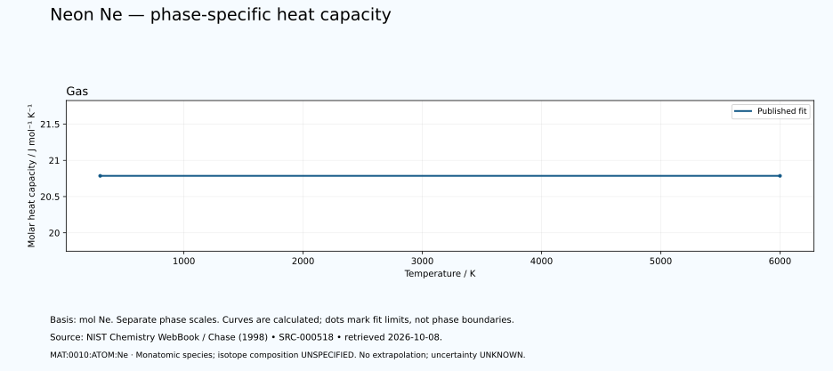

# Neon — thermal functions and phase-specific heat capacity

<!-- generated-by: sync-thermochemistry.mjs -->

1 published Shomate fits are available in this dated NIST Chemistry WebBook extraction. The neon basis is one mole of neutral Ne atoms. The listed monatomic gas species is not a dimer, an isotope-specific equation of state or all species in an equilibrium vapour.

Canonical subject: **MAT:0010:ATOM:Ne** (ATOM), defined by the [unchanged curated owner](data/structured/0010-Neon-Ne-Neutral-Atom.yaml) at `/entity`. Parent element identity: [unchanged master](data/structured/0010-Neon-Ne.yaml) at `/identity`. This DEFINITIONAL identifier supplies no measured state, isotope, excitation, medium or measurement conditions. Molecular spin-isomer scope is **NOT-APPLICABLE-TO-MONATOMIC-SPECIES**. Isotopic composition is **UNSPECIFIED-IN-RETAINED-FIT**. No particular isotope, dimer population, cryogenic equilibrium or superfluid transition is inferred.
 The element's wider thermal domain remains PARTIAL.

[Parent record](0010-Neon-Ne.md) · [Structured coefficients](data/structured/0010-Neon-Ne-NIST-Thermochemistry.yaml) · [Calculated table](tables/0010-Neon-Ne-TABLE-010-Thermodynamic-Functions.md) · [CSV](tables/0010-Neon-Ne-TABLE-010-Thermodynamic-Functions.csv)

Source: **SRC-000518**, [NIST Chemistry WebBook](https://webbook.nist.gov/cgi/cbook.cgi?ID=C7440019&Units=SI&Mask=1), retrieved 2026-10-08. [Retained coefficient source](../../data/catalog/sources/nist-thermochemistry-0010-2026-10-08.html.txt) and [publisher's rounded comparison table](../../data/catalog/sources/nist-thermochemistry-0010-2026-10-08-table.html.txt) preserve the exact downloaded bytes and their SHA-256 hashes. The original evaluation is Chase (1998), with each earlier review date retained below.

## Applicable states and intervals

| Fit | Source phase variant | Valid T / K | Source comment |
|---|---|---:|---|
| GAS:1 | UNSPECIFIED-IN-FIT-TABLE | 298–6000 | Data last reviewed in March, 1982 |

A fit interval describes where the publisher supplies coefficients. Its endpoints are not automatically melting points, boiling points or equilibrium phase boundaries. Alternative solid phases may have overlapping ranges. The source's unspecified crystal structure is UNKNOWN. Each gas fit concerns its listed species; dissociation and ionisation equilibria are not calculated. Standard thermochemical functions do not supply arbitrary-pressure behaviour.

## Equations and reference states

With t = T/1000 and T in kelvin, use the exact source A–H coefficients in their published mixed-unit convention:

- Cp° = A + B·t + C·t² + D·t³ + E/t², in J mol⁻¹ K⁻¹.
- H°(T)−H°(298.15 K) = A·t + B·t²/2 + C·t³/3 + D·t⁴/4 − E/t + F − H, in kJ mol⁻¹.
- S° = A·ln(t) + B·t + C·t²/2 + D·t³/3 − E/(2·t²) + G, in J mol⁻¹ K⁻¹.

The last H is a coefficient, not the temperature-dependent enthalpy. Phase-specific reference offsets matter: do not splice enthalpy increments from different phases or interpret coefficient H as latent heat. The 298.15 K reference does not permit extrapolating a high-temperature fit down to 298.15 K. Outside-range evaluation is rejected. Unpublished coefficient uncertainty and covariance remain UNKNOWN; no error bars or extra physical precision are invented.

## Fit-specific scientific review

**SOURCE-SCOPE-LIMITATION: MAT:0010:THERMO:REVIEW:01.** The retained species is neutral monatomic Ne GAS, CAS7440-01-9. The existing MAT:0010:ATOM:Ne /entity definition and unchanged parent /identity supply explicit identity only, not an observed sample, isotope, excited state or medium. Use mol Ne with one atom per source formula. No Ne2, ion, compound, plasma, condensed phase or equilibrium dissociation/ionisation mixture is inferred. Molecular spin-isomer scope is NOT-APPLICABLE-TO-MONATOMIC-SPECIES; fit isotope composition is UNSPECIFIED-IN-RETAINED-FIT. Source: SRC-000518. Evidence: SOURCE-TRANSCRIBED; INDEPENDENT-SCIENTIFIC-REVIEW-PENDING.

**SOURCE-SCOPE-LIMITATION: MAT:0010:THERMO:REVIEW:02.** One GAS Shomate column covers298–6000K. Preserve all eight printed coefficients, including the four nonzero exponent-valued B–E terms, and all59 publisher rows. The raw first row is298K with a rounded negative-zero enthalpy, while the formula references298.15K. Retain the calculated printed-coefficient reference residual without forcing zero. No duplicate inter-fit endpoints, below298K/above6000K extrapolation, fluid EOS, liquid/solid behaviour, cryogenic phase boundary, latent heat or pressure-dependent function follows. Source: SRC-000518. Evidence: SOURCE-TRANSCRIBED; INDEPENDENT-SCIENTIFIC-REVIEW-PENDING.

**SOURCE-SCOPE-LIMITATION: MAT:0010:THERMO:REVIEW:03.** Chase1998, March1982 source review, retained7October captures, fresh8October2026 exact retrievals and this software/source review are distinct provenance. The source one-bar entropy datum does not establish arbitrary applied sample pressure or fit error: pressure, coefficient uncertainty and covariance remain UNKNOWN. Printed rounding and residuals are computational checks, not physical uncertainty. Publisher tables and independent Python/JavaScript arithmetic evaluate the same compilation; no independent calorimetry or experimental replication is claimed. JANAF index SRC-000341, ASD, selected optical lines, He–Ne laser and Ne21 NMR works remain distinct. Retained copyright/reserved-rights text supplies no inferred open redistribution licence. Source: SRC-000518. Evidence: SOURCE-TRANSCRIBED; INDEPENDENT-SCIENTIFIC-REVIEW-PENDING.

## Heat-capacity chart

Each panel uses its own temperature scale. Lines sample the published equation; they are not observations or phase-stability predictions. Unknown uncertainties are not zero. These calculated charts supplement the chapter and do not replace any of the 22 requested illustrations.

## Validation and outstanding thermal data

The calculation is checked against the publisher's separately tabulated rounded values and the thermodynamic identities dH/dT = Cp and dS/dT = Cp/T. These checks verify transcription and arithmetic, not independent experimental validity. The source tables retain older evaluations; later measurements and application-specific state conditions need separate review. Thermal conductivity, diffusivity, expansion, pressure dependence, transition enthalpies and a phase diagram remain INSUFFICIENT DATA in this supplement. Existing phase-reference values are preserved for later source reconciliation.
