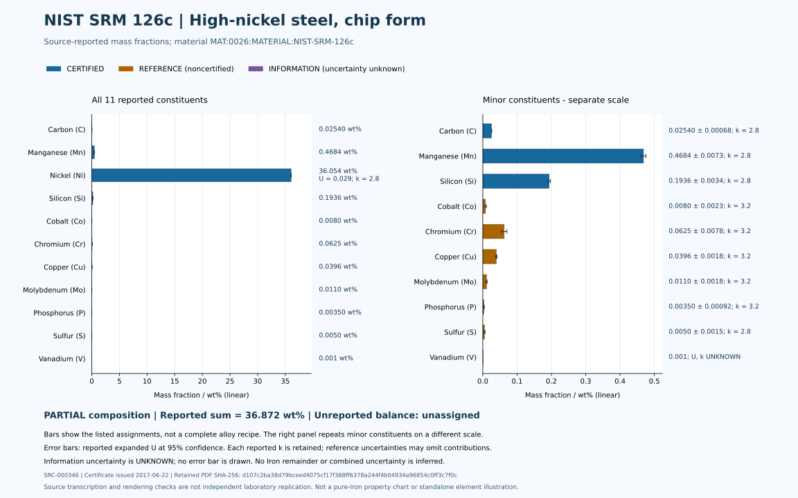
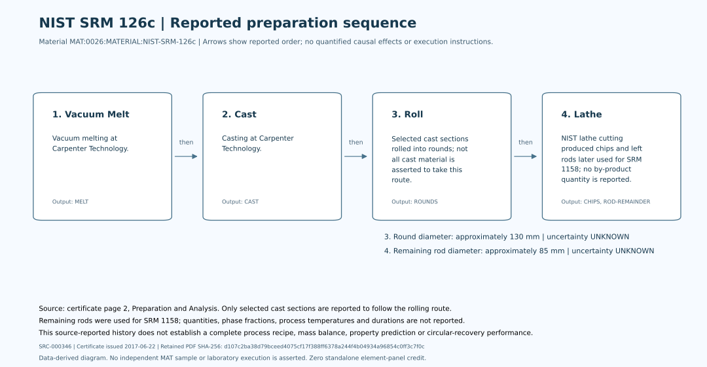

# NIST SRM 126c - material visual reference

<!-- generated-by: build-material-visuals.mjs -->

**MAT:0026:MATERIAL:NIST-SRM-126c** is a high-nickel steel reference material, distinct from [pure Iron's element record](0026-Iron-Fe.md). Its 11 assignments and four ordered preparation steps are projections of the [existing material owner](data/properties/0026-Iron-Fe-SRM-126c.yaml); they do not introduce a second numeric record.

Source **SRC-000346**: [NIST Certificate of Analysis](<https://tsapps.nist.gov/srmext/certificates/126c.pdf>), issued 2017-06-22, retrieved 2026-10-03. The [retained PDF](../../data/research/sources/nist-srm-126c-2017-06-22.pdf) has SHA-256 **d107c2ba38d79bceed4075cf17f388ff6378a244f4b04934a96854c0ff3c7f0c**. Source text transcription and software checks are separate from independent laboratory replication.

## Source-reported assignments

[Full table, expanded uncertainties U, coverage factors k, method codes and certificate locators](tables/0026-Iron-Fe-TABLE-SRM-126c-Composition.md). Four assignments are CERTIFIED, six REFERENCE and one INFORMATION. The displayed arithmetic sum is **36.872 wt%**, with **PARTIAL** coverage. The unreported balance remains unassigned.

The left panel includes every reported constituent on a linear scale. The right panel repeats the minor constituents on its explicitly different linear scale; it omits the largest reported value only for readability. Bar colours retain the certificate's assignment status. Error bars show plus/minus the source-reported expanded U at 95% confidence; each constituent's k appears in the adjacent row annotation and in the table. No error bar is drawn for the INFORMATION value because its uncertainty is UNKNOWN. No normalisation, Iron remainder or whole-composition pie chart is made.

## Ordered preparation history

1. **vacuum melt** - Vacuum melting at Carpenter Technology. Source: Page 2, Preparation and Analysis.
2. **cast** - Casting at Carpenter Technology. Source: Page 2, Preparation and Analysis.
3. **roll** - Selected cast sections rolled into rounds; not all cast material is asserted to take this route. round diameter: approximately 130 mm. Source: Page 2, Preparation and Analysis.
4. **lathe** - NIST lathe cutting produced chips and left rods later used for SRM 1158; no by-product quantity is reported. remaining rod diameter: approximately 85 mm. Source: Page 2, Preparation and Analysis.

Arrows indicate the certificate's reported preparation order. They are not evidence of a quantified causal effect, a reproducible laboratory procedure, or authorization to execute equipment. The approximate geometry is source-reported; its measurement uncertainty and machining conditions are UNKNOWN. Remaining rods are described as used for SRM 1158, but their quantity, composition allocation and circular recovery performance are not reported.

## Evidence limits and continuation

- Only reported constituents are represented. The unreported balance is not assigned to iron. No combined uncertainty or complete recipe is inferred.
- Source-reported reference material; no physical sample is held or measured by MAT.
- REFERENCE assignments are noncertified and their uncertainties may omit contributions. INFORMATION values have no established uncertainty or metrological traceability.
- Certificate transcription and software validation are not independent laboratory replication. No property prediction, complete alloy recipe or uncertainty aggregation is made.

- Phase fractions, measurement temperature, process temperature and duration remain UNKNOWN.
- The certificate's 200 mg recommendation is analytical context, not a MAT execution instruction.
- These data-derived charts supplement the material record and receive **zero credit** toward the 22 required standalone element illustrations. They do not make the Iron scientific record complete.

[Generation receipt](../../data/quality/material-visuals-srm126c.json) records input and output byte hashes. The read-only freshness check is `node scripts/build-material-visuals.mjs --check`; regeneration refuses to overwrite artifacts edited since the receipt. Future additions require separate source-backed owners for complete composition, covariance, measured sample conditions and property or performance evidence.
